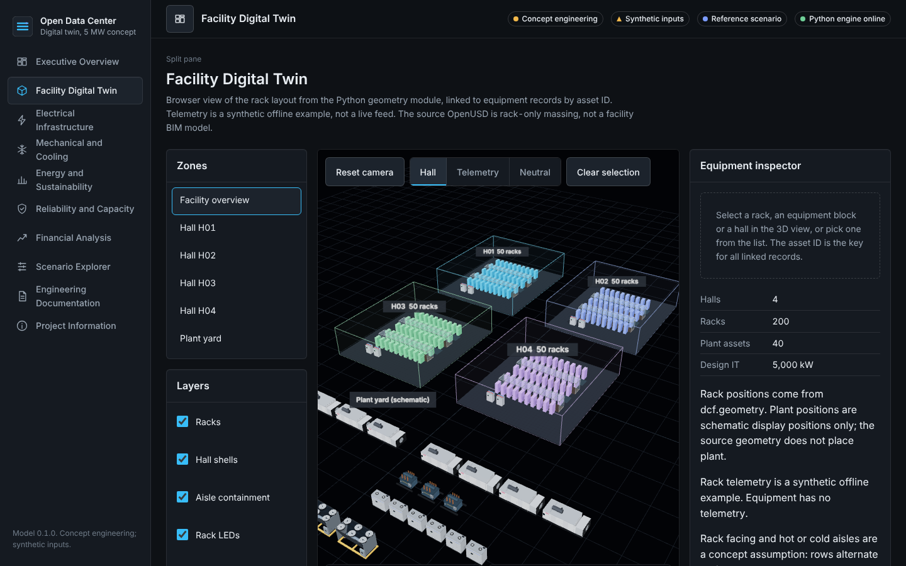
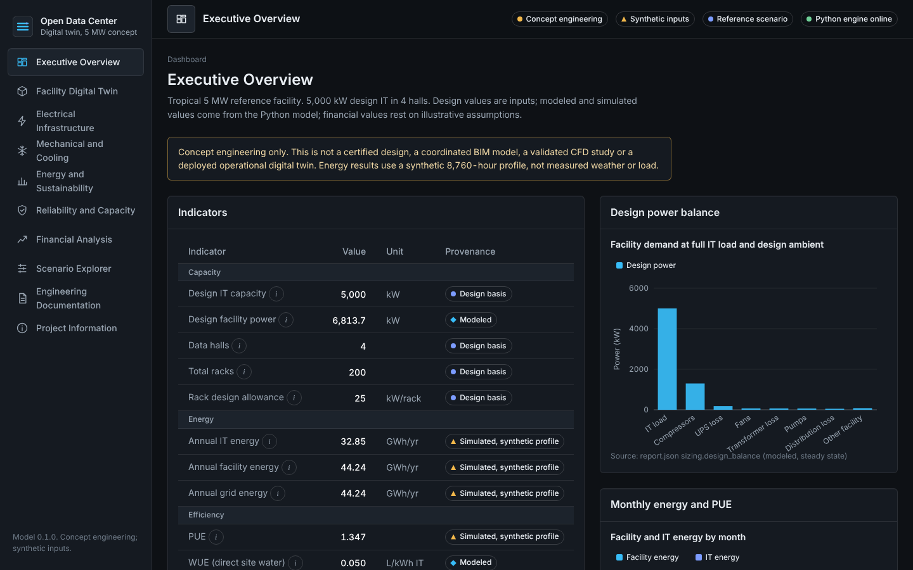
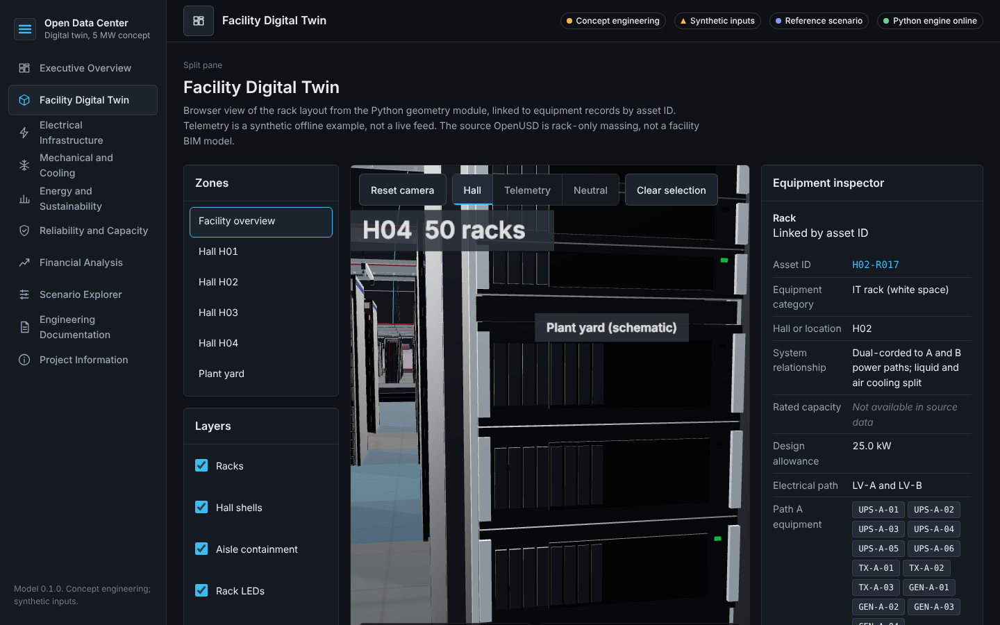
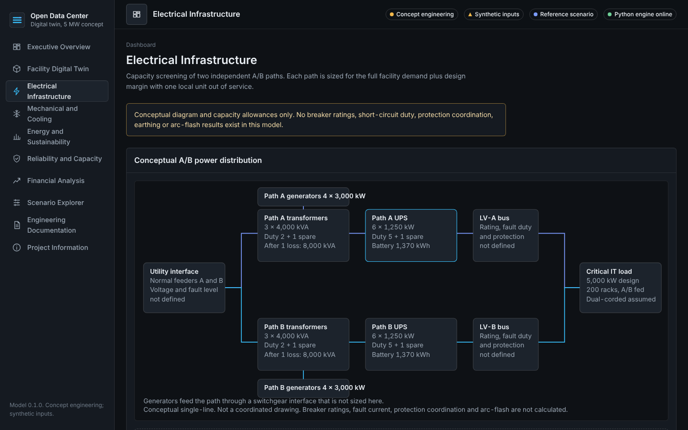
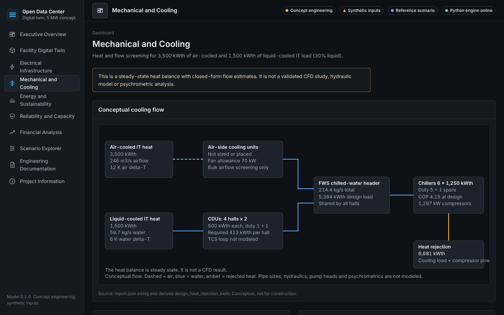
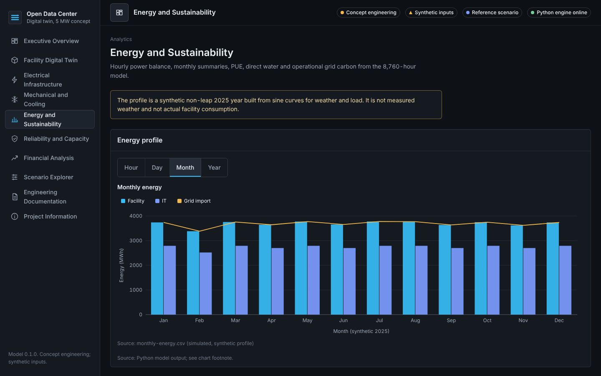
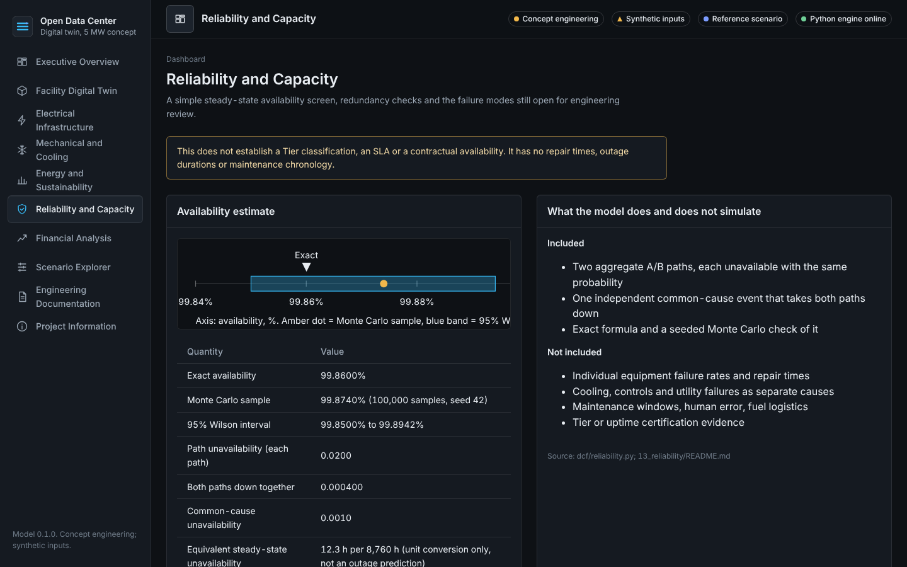
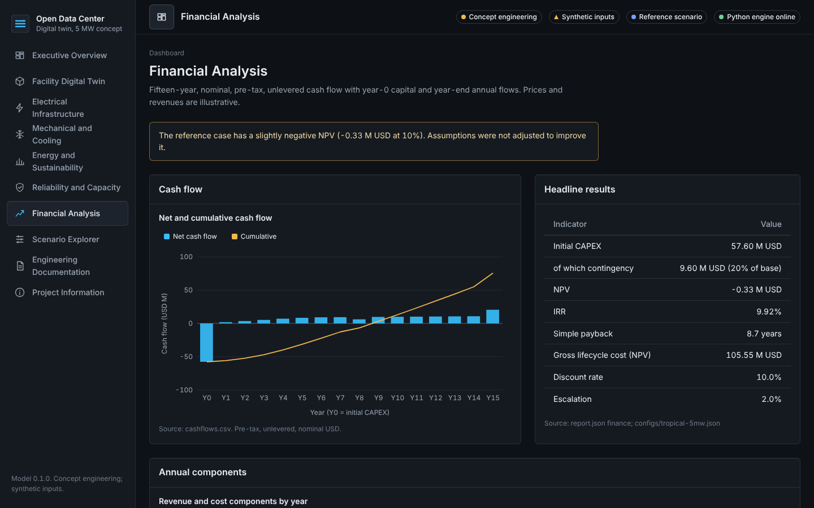
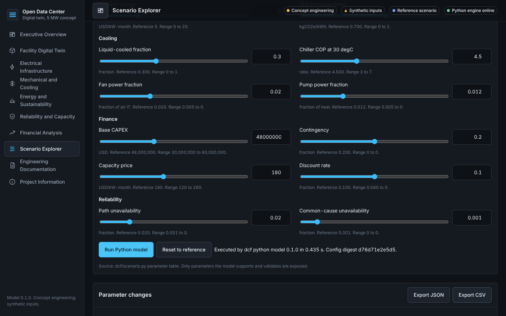
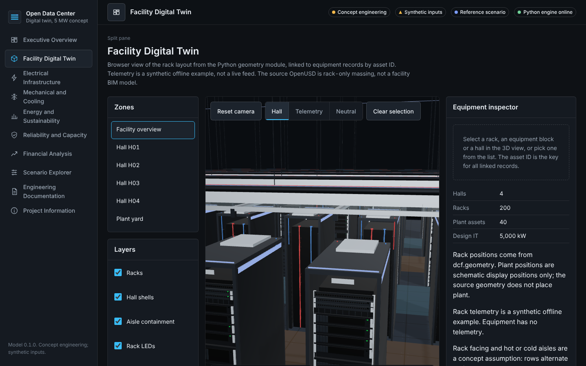

# Open Data Center Facility

**A reproducible 5 MW data center concept study, now with an interactive digital twin that runs the real Python model.**

Created by **Jonathan Oktaviano** for public engineering learning and contribution.



## 1. Status and honest scope

Maturity: **concept engineering**. This is not a certified facility design, not a BIM model, not CFD, and not an operational digital twin. Weather, load, tariffs, costs and telemetry are synthetic or illustrative. The project is independent and has no affiliation with AWS or any other hyperscaler. The reference result is kept as computed: NPV is slightly negative (about -0.33 M USD).

## 2. The reference facility

5 MW design IT, four halls, 200 racks at 25 kW, A and B electrical paths, air and liquid cooling, synthetic tropical climate, 15 year pre-tax unlevered finance.

## 3. What is new: the interactive digital twin

A browser interface with ten modules. Python stays the only calculation engine; the browser draws and formats.

| Module | What you can do |
| --- | --- |
| Executive Overview | Read 17 KPIs, each with provenance and a source pointer |
| Facility Digital Twin | Orbit the 3D halls, click a rack or equipment block, read its asset ID, relations and synthetic telemetry |
| Electrical | Follow the single line diagram, check N+1 utilisation |
| Mechanical and Cooling | Cooling flow, COP against ambient, daily profile |
| Energy and Sustainability | Hour, day, month and year views of power, PUE, carbon, PV |
| Reliability and Capacity | Availability interval, FMEA, maintenance matrix, offline cases |
| Financial Analysis | Cash flow, components, NPV sensitivity, CSV export |
| Scenario Explorer | Change 19 parameters, run the real model, compare with baseline, export CSV or JSON |
| Engineering Documentation | Browse the repository documents |
| Project Information | Scope, maturity and limits |

## 4. Quick start

Requires Python 3.11 or newer and Node 22 or newer.

```bash
python -m dcf.cli web-data          # export the data contract
cd web && npm ci && npm run build   # build the interface
cd .. && python -m dcf.cli serve    # open http://127.0.0.1:8765
```

The Python only workflow still works with no dependencies:

```bash
python -m dcf.cli validate
python -m dcf.cli run --output build/reference
python -m unittest discover -s tests -v
python scripts/verify_repository.py
```

Windows users can substitute `py -3` for `python`.

## 5. Screenshots

Captured from the running application at 1440 by 900 with a software renderer.

| | |
| --- | --- |
|  |  |
| Executive Overview | Rack inspector, asset ID H02-R017 |
|  |  |
| Electrical | Mechanical and Cooling |
|  |  |
| Energy and Sustainability | Reliability and Capacity |
|  |  |
| Financial Analysis | Scenario Explorer, dense racks 35 kW preset |

Responsive captures at 1920, 1440, 1366, 768 and 390 pixels wide are in `assets/screenshots/responsive/`.

## 6. Scenario Explorer

Presets and sliders map to a whitelist in `dcf/scenario.py`. Every change is validated by the same `dcf.config.validate` that checks the reference. The result shows both columns from the Python model, the config digest and run time. The reference configuration is never written. Known limit: CAPEX is a fixed input, so a dense rack scenario raises IT energy by 40 percent without changing CAPEX.

## 7. Architecture

```text
configs/*.json -> dcf (Python) -> artifacts/reference (SHA-256) -> dcf.webdata -> build/web-data/*.json -> web/
                                        POST /api/scenario/run -> dcf.scenario (live run) ^
```

Details and the contract: [docs/architecture/data-flow.md](docs/architecture/data-flow.md).

### 7a. 3D models

The 3D view uses original procedural models, not scans and not vendor files. A rack is a 42U, 600 by 1200 mm class cabinet with 19 inch rails, 2U and 4U servers with drive bays and vents, switches, patch panel, A and B PDUs with outlets, and a supply and return liquid manifold. Each rack is about 4,400 triangles; 200 racks at full detail is about 0.9 million triangles, and halls 35 to 70 m away show a medium model and farther halls a box stand-in. Plant: UPS cabinet, oil filled transformer with bushings and radiator fins, enclosed generator with silencer and radiator, air cooled chiller with V coils and fans, and a CDU with manifolds. A generic overhead ladder cable tray (power A, power B, data bundles, hangers) runs above each rack row. Hot aisles have a generic glazed containment roof and end doors; cold aisles carry a blue floor marker. Rack facing and the aisle plan come from the Python model (`dcf.geometry.aisles`) as a labelled concept assumption, and no rack moves. The sun casts soft shadows from racks, trays and plant. Each rack unit has a status LED that blinks at a rate set by the synthetic rack telemetry (illustration only, not a real status signal). All carry the label "generic". Dimensions follow the display footprint in the data contract.



NVIDIA SimReady and DSX assets are **not included**. The DSX sample data is licensed for evaluation only and is not for production use, so it must not be committed to this MIT repository. To use your own GLB files, put `rack.glb`, `ups.glb`, `tx.glb`, `gen.glb`, `chl.glb` or `cdu.glb` in `web/public/models/` (git ignored). They replace the generic models when the server finds them. Only geometry and base colours are used; convert OpenUSD to GLB yourself and check each asset licence.

## 8. Data provenance

Four classes: design, modeled, simulated, financial. Every value carries a synthetic flag. Chips show provenance with shape and text. Telemetry shows value, timestamp, source, quality and a synthetic flag.

## 9. Verification

| Check | Result |
| --- | --- |
| Python unit tests | 47 passed |
| `scripts/verify_repository.py` | PASS |
| TypeScript strict, ESLint | 0 errors |
| Frontend tests | 41 passed |
| Production build | exit 0 |
| Browser sweep, 10 routes, no console errors | passed |
| Horizontal overflow, 7 widths by 10 routes | 0 |

Not yet verified: remote GitHub Actions, real GPU, screen readers, Firefox and Safari. See [docs/validation/final-acceptance-report.md](docs/validation/final-acceptance-report.md).

## 10. Limitations

- Plant positions in 3D are schematic; only racks come from source geometry.
- Equipment shapes are generic models built from common public dimensions, not vendor or NVIDIA assets (see section 7a).
- OpenUSD and DXF are rack massing, not facility BIM.
- Scenario CAPEX is fixed; PV scenarios carry no PV investment.
- The scenario module needs the local Python server.

## 11. Review the work

| Audience | Entry point |
|---|---|
| Recruiter / portfolio reviewer | [Portfolio dossier](deliverables/facility-portfolio.pdf), [executive memo](00_executive/investment-memo.md) |
| Engineer | [Design basis](01_requirements/design-basis.md), [methodology](docs/model-methodology.md), [requirements traceability](01_requirements/traceability.csv) |
| Analyst | [Editable engineering and finance workbook](deliverables/facility-model.xlsx), [cash-flow method](03_financial-model/README.md) |
| Researcher | [Evidence synthesis](research/research-synthesis.md), [source register](research/source-register.md), [integration contracts](integrations/README.md) |
| Operator | [Commissioning plan](15_commissioning/commissioning-plan.md), [operations handbook](16_operations/README.md) |
| Contributor | [Contributing](CONTRIBUTING.md), [architecture](ARCHITECTURE.md), [maturity map](docs/maturity.md), [PDF publication style](docs/publication-style.md) |

## 12. What runs today

- Validated capacity and conservative per-path N+1 screening for UPS, transformers, generators, chillers and CDUs; battery and BESS energy allowances.
- Reproducible 8,760-hour power and thermal balance, monthly tariffs, energy-weighted PUE, direct-site WUE, grid carbon and optional PV self-consumption.
- Fifteen-year, pre-tax, unlevered facility cash flows, CAPEX and OPEX, NPV, conventional IRR, gross lifecycle cost and nine sensitivity cases.
- Eligibility-gated site ranking, analytical and seeded Monte Carlo availability, six offline supervisory scenarios.
- Original SVG and DXF rack layout, OpenUSD rack massing, matching asset schedule and synthetic telemetry.
- The interactive digital twin described above.

## 13. Documentation

Index: [docs/README.md](docs/README.md). Audit: [docs/audit/](docs/audit/). Claim to evidence table: [documentation-traceability.csv](docs/audit/documentation-traceability.csv).

## 14. Roadmap

Scenario CAPEX scaling needs an owner decision on the cost model. A static demo without Python would need precomputed scenarios. Live telemetry, BIM plant geometry and CFD are outside this concept stage.

## 15. Repository map

```text
00_executive/          Charter, investment memo, concept feasibility
01_requirements/       OPR, design basis, assumptions, traceability
02_site-selection/    Gated site-screening and due diligence
03_financial-model/   Cost allowances, model conventions, sensitivities
04_architecture/      Systems, interfaces, maintainability
05_electrical/        Concept SLD, sizing and study specifications
06_mechanical/        Air/liquid cooling and loop concept
07_energy/            Metering, hourly balances, PV/BESS boundaries
08_cad-bim/           Geometry basis and accommodation schedule
09_cfd/               Airflow baseline and CFD validation specification
10_control-system/   BMS/EPMS points, alarm and control narrative
11_digital-twin/      Asset/telemetry contract and USD example
12_dcim/              Asset lifecycle and capacity reconciliation
13_reliability/       FMEA, common-cause model, maintenance matrix
14_sustainability/   Carbon, water, lifecycle boundaries
15_commissioning/    FAT/SAT/IST evidence and offline cases
16_operations/       SOP/MOP/EOP, maintenance and dashboard specification
17_delivery/         Procurement, construction and handover gates
18_assurance/        Safety, fire, security and code-review registers
dcf/                 Dependency-free calculation library and CLI
configs/ data/       Versioned scenario and synthetic input records
schemas/ tests/      Input contract and meaningful model tests
research/            Primary sources, evidence gaps and synthesis
integrations/        Optional external simulation workflows
artifacts/reference/ Reproducible CSV/JSON/SVG/DXF/USD evidence
deliverables/        Portfolio PDF and editable workbook
docs/ scripts/       Methods, contribution workflow and verification
```

## 16. Contributing

See [CONTRIBUTING.md](CONTRIBUTING.md), [architecture](ARCHITECTURE.md) and [governance](GOVERNANCE.md). Run the checks in section 4 and section 9 before opening a pull request.

## 17. License

Original project material is released under [MIT](LICENSE); upstream works retain their own terms. No vendor logos, drawings or proprietary standards are included. Citation: [CITATION.cff](CITATION.cff).
